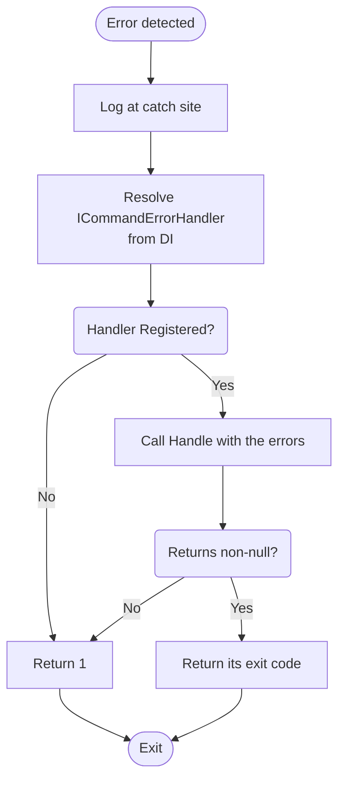

# Custom Global Error Handler

`Albatross.CommandLine` provides the @Albatross.CommandLine.ICommandErrorHandler interface to plug in custom error reporting. Every error condition the pipeline detects is routed to it — not only exceptions thrown by a command handler.

## How It Works

The pipeline captures each failure as an @Albatross.CommandLine.Error record and passes it to the registered `ICommandErrorHandler`:

| `ErrorSource` | Raised when | `Error.Symbol` |
|---|---|---|
| `CommandHandler` | An exception escapes the command handler | Command key |
| `OptionHandler` | An option handler throws, or records a validation failure with `ICommandContext.SetInputActionError` | Option name |
| `ServiceRegistration` | The command handler cannot be resolved or created from the DI container | Command key |
| `CommandTaskCancellation` | The command handler is cancelled (`OperationCanceledException`, typically Ctrl+C) | Command key |
| `OptionTaskCancellation` | An option handler throws `OperationCanceledException` | Option name |

Each `Error` carries its `Source`, `Symbol`, a user-facing `Message`, and the underlying `Exception` when there is one (it is null for a validation failure or a cancellation). Several option handlers can fail in one invocation, so the handler receives the errors as a set.

The error is **logged where it is caught**, before the handler runs. The handler's job is only to tell the user:

- If the handler returns a **non-null** exit code, that code is returned.
- If no handler is registered, or `Handle` returns **null**, the exit code is `1`.



## Interface Definition

```csharp
public interface ICommandErrorHandler {
    /// Called with one or more error conditions collected during command execution.
    /// Return a non-null exit code to override the default; return null to fall through.
    int? Handle(params IEnumerable<Error> errors);
}
```

## Using the Built-in Handler

`Albatross.CommandLine.Outputs` ships `GlobalErrorHandler`, which writes a `CommandOutput` envelope with an `errors[]` array to stderr — the same JSON shape the command uses for its own output. It returns `1`, or `130` when every error is a cancellation. Register it to opt in:

```csharp
services.AddSingleton<ICommandErrorHandler, GlobalErrorHandler>();
```

Subclass it to change the conversion of each error (`Convert`) or to report a log folder (`GetLogFolderPath`).

## Implementing a Custom Handler

```csharp
public class MyErrorHandler : ICommandErrorHandler {
    public int? Handle(params IEnumerable<Error> errors) {
        int? exitCode = null;
        foreach (var error in errors) {
            switch (error.Exception) {
                case ValidationException validationEx:
                    Console.Error.WriteLine($"Validation failed: {validationEx.Message}");
                    exitCode ??= 2;
                    break;
                case UnauthorizedAccessException:
                    Console.Error.WriteLine("Access denied: execute with elevated privilege");
                    exitCode ??= 3;
                    break;
                default:
                    Console.Error.WriteLine(error.Message);
                    break;
            }
        }
        // Return null to fall through to the default exit code (1)
        return exitCode;
    }
}
```

## Registration

Register the handler in your DI setup:

```csharp
static void RegisterServices(ParseResult result, IServiceCollection services) {
    services.AddSingleton<ICommandErrorHandler, MyErrorHandler>();
    services.RegisterCommands();
}

await using var host = new CommandHost("My App")
    .RegisterServices(RegisterServices)
    .AddCommands()
    .Parse(args)
    .Build();
return await host.InvokeAsync();
```

> [!NOTE]
> Only one `ICommandErrorHandler` can be registered. If you need to handle multiple error types, dispatch within a single implementation.

## Exit Codes

The library reserves no exit codes. What distinguishes one failure from another is `Error.Source`, so the handler is where an outcome is explained and mapped to a code. Without a handler, or when it returns null, every failure exits with `1`.
